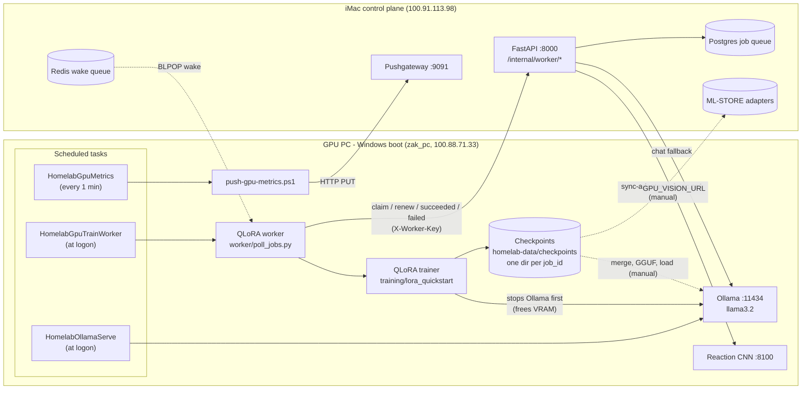
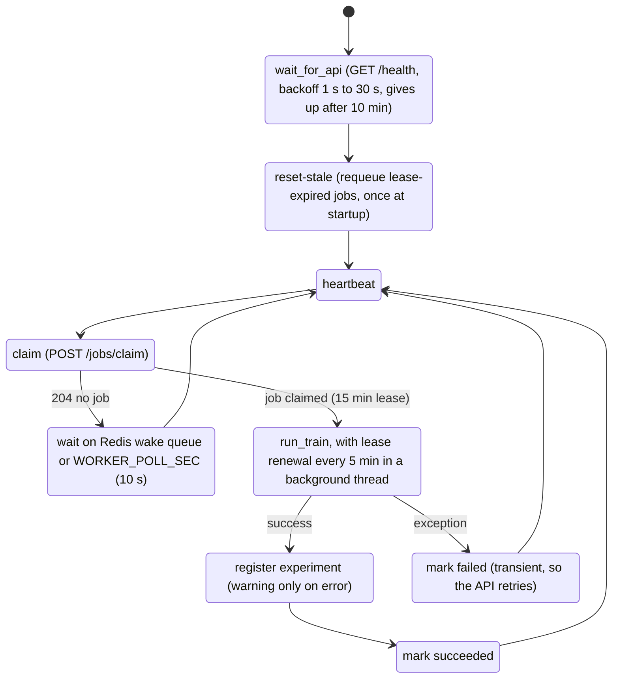

<div align="center">

# homelab-gpu

**The Windows side of the RTX 5070 GPU PC: Ollama inference, the QLoRA train worker for the iMac job queue, and GPU metrics.**

   

[homelab](https://github.com/zakiscoding/homelab) (docs hub) · [homelab-services](https://github.com/zakiscoding/homelab-services) · [homelab-web](https://github.com/zakiscoding/homelab-web) · **homelab-gpu** · [gpu-systems-lab](https://github.com/zakiscoding/gpu-systems-lab)

</div>

---

> This repo runs on the GPU PC's **Windows boot** (`zak_pc`, user `zakar`, Tailscale `100.88.71.33`). The same machine's **Ubuntu boot** (vLLM, CUDA/MPI lab, k3s, DCGM) is [gpu-systems-lab](https://github.com/zakiscoding/gpu-systems-lab). The PC runs one OS at a time, never both.

## What's inside

- **Ollama** on `0.0.0.0:11434` (llama3.2): the chat fallback when vLLM on Ubuntu is down. The iMac API picks the backend automatically (`LLM_BACKEND=auto`).
- **QLoRA train worker** (`worker/`). It polls the iMac API for `train` jobs, claims one under a 15-minute lease, renews the lease every 5 minutes, trains, and reports the result.
- **QLoRA trainer** (`training/lora_quickstart/`). PEFT + bitsandbytes 4-bit on SmolLM2-360M by default. Writes adapters to local disk, never to git.
- **GPU metrics push.** `nvidia-smi` readings go to the iMac Pushgateway every minute.
- **Reaction CNN** on `:8100`. Serves `POST /infer/reaction` for the homelab-web Reactions page. The serve code is not in this repo yet (see [Reaction vision](#reaction-vision-port-8100)).
- **PowerShell helpers** (`scripts/`) for the venv, Ollama, the worker, scheduled tasks, Jupyter, and adapter sync.

## Architecture



### Worker lifecycle

What `python -m worker.poll_jobs` does, from [`worker/poll_jobs.py`](worker/poll_jobs.py):



- The lease keep-alive posts to `/internal/worker/jobs/{id}/renew` every `WORKER_LEASE_RENEW_SEC` (300 s). Without it, a run longer than 15 minutes is requeued by the API's lease sweep and can run twice. Renew errors (for example 409, job taken over) are logged and never raised.
- Training is idempotent. Artifacts live under `checkpoints/{job_id}/`, and if `published.json` already exists the job returns the existing manifest without retraining.
- `--once` runs a single cycle and exits. `run-worker-once.ps1` and `run-worker-detached.ps1` use it.
- The worker only claims plain `train` jobs. Jobs with `payload.route` go to the router worker in [gpu-systems-lab](https://github.com/zakiscoding/gpu-systems-lab).

## Quickstart

On the GPU PC (Windows), in PowerShell:

```powershell
# 1. Clone and create the venv (installs requirements.txt)
git clone https://github.com/zakiscoding/homelab-gpu.git C:\Users\zakar\homelab-gpu
cd C:\Users\zakar\homelab-gpu
.\scripts\setup-venv.ps1
.\scripts\verify-gpu.ps1                      # nvidia-smi + torch CUDA check

# 2. Configure: copy the template, then fill in values (never commit .env)
Copy-Item .env.example .env
notepad .env                                  # API_BASE_URL, WORKER_API_KEY, CHECKPOINT_DIR, ...

# 3. Ollama on 0.0.0.0:11434 (Administrator, once: scheduled task + firewall rule)
.\scripts\install-ollama-serve-task.ps1
.\scripts\start-ollama.ps1                    # later: start it and list models

# 4. Train worker: foreground for a first test, then as a scheduled task (Administrator)
.\scripts\start-gpu-worker.ps1                # Ctrl+C to stop
.\scripts\register-gpu-worker-task.ps1
Start-ScheduledTask -TaskName HomelabGpuTrainWorker

# 5. GPU metrics push to the iMac Pushgateway (every 1 min)
.\scripts\register-gpu-metrics-task.ps1
```

Check it from the laptop or iMac:

```powershell
curl.exe http://100.88.71.33:11434/api/tags
```

## Layout

| Path | Purpose |
|------|---------|
| [`worker/poll_jobs.py`](worker/poll_jobs.py) | Train worker loop: wait for the API, reset stale jobs, heartbeat, claim, lease keep-alive, report |
| [`worker/run_train.py`](worker/run_train.py) | Train handler: `TRAIN_MODE=qlora` (default) or `stub`, idempotent per `job_id` |
| [`worker/job_wake.py`](worker/job_wake.py) | Blocks on the Redis wake queue `homelab:jobs:wake:train` |
| [`training/lora_quickstart/`](training/lora_quickstart/) | QLoRA trainer (`train.py`) and `smoke_train.jsonl` fallback dataset |
| [`training/lora-quickstart/README.md`](training/lora-quickstart/README.md) | QLoRA notes: data layout, stacks, export |
| [`scripts/`](scripts/README.md) | PowerShell helpers: venv, Ollama, worker, scheduled tasks, metrics, Jupyter |
| [`scripts/train_once_job.py`](scripts/train_once_job.py) | Run QLoRA for one job id locally (debug, no queue) |
| [`notebooks/`](notebooks/README.md) | JupyterLab notebooks (GPU and path check) |
| [`configs/paths.example.yaml`](configs/paths.example.yaml) | Example paths and base model; copy to `paths.yaml` (gitignored) |
| [`.env.example`](.env.example) | Environment variable names (template) |
| [`requirements.txt`](requirements.txt) | torch, transformers, peft, bitsandbytes, httpx, redis, jupyterlab |

Not in git: model weights, checkpoints, datasets, `.venv/`, Ollama models, `.env`. Keep data under `C:\Users\zakar\homelab-data\`.

## Operations

### Scheduled tasks

| Task | Registered by | Runs | Action |
|------|---------------|------|--------|
| `HomelabOllamaServe` | `install-ollama-serve-task.ps1` (Admin) | At logon, restarts on failure | `ollama serve` with `OLLAMA_HOST=0.0.0.0:11434` |
| `HomelabGpuTrainWorker` | `register-gpu-worker-task.ps1` (Admin) | At logon | `start-gpu-worker-bg.ps1` (hidden `python -m worker.poll_jobs`) |
| `HomelabGpuMetrics` | `register-gpu-metrics-task.ps1` | Every 1 min | `push-gpu-metrics.ps1` to the Pushgateway |

```powershell
Get-ScheduledTask -TaskName Homelab* | Select TaskName, State
Start-ScheduledTask -TaskName HomelabGpuTrainWorker
```

`Stop-ScheduledTask` does not stop the worker: `start-gpu-worker-bg.ps1` launches a hidden python process and exits. See [Updating](#updating) for how to stop it.

### Health checks

| Check | Command |
|-------|---------|
| Ollama up | `curl.exe http://127.0.0.1:11434/api/tags` |
| Ollama listening | `Get-NetTCPConnection -LocalPort 11434 -State Listen` |
| GPU and VRAM | `nvidia-smi` or `.\scripts\verify-gpu.ps1` |
| Worker running | `Get-CimInstance Win32_Process -Filter "Name='python.exe'"` and look for `worker.poll_jobs` in `CommandLine` |
| One worker cycle | `.\scripts\run-worker-once.ps1` |
| Metrics push | `.\scripts\push-gpu-metrics.ps1` (prints util and memory) |

### Logs

| Source | Where |
|--------|-------|
| Foreground worker (`start-gpu-worker.ps1`) | The console (`[worker] ...` lines) |
| Detached worker cycle (`run-worker-detached.ps1`) | `C:\Users\zakar\homelab-data\worker-last.log` / `.err` |
| Detached train (`run-train-detached.ps1 -JobId <uuid>`) | `C:\Users\zakar\homelab-data\train-last.log` / `.err` |
| Job artifacts | `<CHECKPOINT_DIR>\<job_id>\` (`manifest.json`, `published.json`, `adapter\`) |

The scheduled-task worker runs hidden with no log file. To see its output, stop the hidden worker (see [Updating](#updating)) and run `start-gpu-worker.ps1` in the foreground.

The detached scripts survive an SSH disconnect, so use them when driving the PC remotely.

### Ollama and training VRAM

Ollama and QLoRA share the 12 GB card. The trainer calls `stop-ollama.ps1` itself before each QLoRA run. To do it by hand:

```powershell
.\scripts\stop-ollama.ps1                     # stop Ollama, then show nvidia-smi
# ... train ...
.\scripts\start-ollama.ps1                    # or: schtasks /Run /TN HomelabOllamaServe
```

vLLM runs only on the Ubuntu boot, so while Ollama is stopped on Windows the homelab has no chat backend. Chat is down until Ollama restarts.

### After training

- Adapters land in `<CHECKPOINT_DIR>\<job_id>\adapter`. The job's experiment record on the iMac points there.
- Copy an adapter to the iMac ML-STORE: `.\scripts\sync-adapter-to-imac.ps1 -JobId <uuid> -ModelVersion my-lora-v1` (scp to host alias `imac-ts`).
- Serving a fine-tune in Ollama is manual: merge the adapter, convert to GGUF, then load it into Ollama.

### Updating

```powershell
cd C:\Users\zakar\homelab-gpu
git pull
pip install -r requirements.txt               # only if requirements.txt changed (inside .venv)
# The task only launches a hidden python process, so stop that process directly
Get-CimInstance Win32_Process -Filter "Name='python.exe'" |
  Where-Object CommandLine -match 'worker.poll_jobs' |
  ForEach-Object { Stop-Process -Id $_.ProcessId }
Start-ScheduledTask -TaskName HomelabGpuTrainWorker
```

Check that no train job is running before you restart. An interrupted job's lease expires and the API requeues it.

### Reaction vision (port 8100)

A FER CNN on `0.0.0.0:8100` serves `POST /infer/reaction` for the homelab-web Reactions page. The iMac reaches it through `GPU_VISION_URL` in the homelab-services `.env`. The serve code and its start script are **not in this repo yet**. Docs: [homelab vision-reactions.md](https://github.com/zakiscoding/homelab/blob/main/docs/services/vision-reactions.md).

```powershell
curl.exe http://127.0.0.1:8100/health
```

It competes with Ollama and training for VRAM. Stop Ollama first if they collide.

## Configuration

Copy `.env.example` to `.env` (gitignored). Names only. Values stay on the PC.

| Variable | Used by | Purpose |
|----------|---------|---------|
| `API_BASE_URL` | worker | iMac API base (default `http://100.91.113.98`) |
| `WORKER_API_KEY` | worker | Sent as `X-Worker-Key`; must match the iMac homelab-services `.env` |
| `WORKER_ID`, `WORKER_HOST` | worker | Worker identity (default: hostname) |
| `WORKER_POLL_SEC` | worker | Idle poll interval (default 10) |
| `WORKER_LEASE_RENEW_SEC` | worker | Lease renew interval (default 300) |
| `WORKER_TRAIN_TIMEOUT_SEC` | worker | HTTP client timeout (default 1800) |
| `REDIS_URL`, `JOB_NOTIFY_ENABLED` | worker | Redis wake queue; falls back to polling if unset |
| `TRAIN_MODE` | trainer | `qlora` (default) or `stub` |
| `TRAIN_MAX_STEPS`, `TRAIN_BASE_MODEL`, `TRAIN_USE_4BIT` | trainer | Steps (30), base model (SmolLM2-360M-Instruct), 4-bit (true) |
| `CHECKPOINT_DIR`, `DATASET_DIR` | trainer | Local data paths under `homelab-data` |
| `PUSHGATEWAY_URL`, `GPU_INSTANCE` | metrics | Pushgateway (default `http://100.91.113.98:9091`), instance label |
| `JUPYTER_LISTEN`, `JUPYTER_PORT` | Jupyter | Bind address (default `127.0.0.1`) and port (8888) |

## Docs

- [scripts/README.md](scripts/README.md): every script and what it does
- [notebooks/README.md](notebooks/README.md): JupyterLab, local and over Tailscale
- [training/lora-quickstart/README.md](training/lora-quickstart/README.md): QLoRA notes
- [homelab gpu-node.md](https://github.com/zakiscoding/homelab/blob/main/docs/nodes/gpu-node.md): GPU PC runbook
- [homelab PHASE-0A.md](https://github.com/zakiscoding/homelab/blob/main/docs/PHASE-0A.md): job queue design

## Related repos

| Repo | Role |
|------|------|
| [homelab](https://github.com/zakiscoding/homelab) | Docs hub: architecture, nodes, services, setup log, runbooks |
| [homelab-services](https://github.com/zakiscoding/homelab-services) | iMac stack: FastAPI, Postgres job queue, Redis, Qdrant, Prometheus/Grafana, MLflow |
| [homelab-web](https://github.com/zakiscoding/homelab-web) | Next.js UI: chat, RAG, reactions, status (iMac :3081) |
| **homelab-gpu** | This repo: GPU PC on Windows (Ollama, QLoRA worker, metrics) |
| [gpu-systems-lab](https://github.com/zakiscoding/gpu-systems-lab) | GPU PC on Ubuntu + Modal: CUDA, MPI/NCCL, vLLM, k3s, DCGM, job router |
